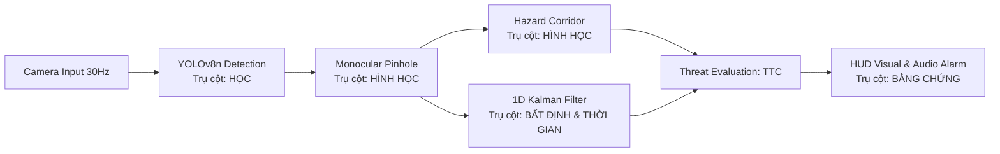

# BÁO CÁO DỰ ÁN CAPSTONE HACKATHON TRACK 4
## Hệ thống Cảnh báo Va chạm Người đi bộ Thời gian thực (VinFast ADAS - PCW)
**Thành viên**: Nguyễn Thanh Bình - 2A202602777, Nguyễn Thanh Hòa - 2A202602559, Nguyễn Triều Vương
**Chương trình**: AI20k · Track 4: Computer Vision & Robotics  
**Đơn vị ứng dụng**: VinFast (Dòng xe ô tô điện VF 3, VF 5, VF 6, VF 8) & Xe buýt điện VinBus  
**Tập tin dữ liệu & kiểm thử đính kèm**: `recordings/eval_telemetry.csv`, `recordings/eval_summary.json` và `test_adas_suite.py`  

---

## 1. TỔNG QUAN BÀI TOÁN & TÁC ĐỘNG THỰC TẾ (IMPACT & USEFULNESS)

### 1.1. Bối cảnh & Nỗi đau thực tế
Tại các đô thị Việt Nam (Hà Nội, TP.HCM), giao thông mang tính chất **hỗn hợp cao** với mật độ xe máy và người đi bộ đan xen dày đặc. Người đi bộ thường xuyên:
* Băng qua đường bất ngờ ở các điểm không có vạch kẻ hoặc bị khuất tầm nhìn bởi xe buýt/xe tải đỗ ven đường.
* Thời gian phản xạ trung bình của tài xế khi nhận biết mối nguy hiểm đến khi đạp phanh là **$1.0 - 1.5\text{ giây}$**. Ở dải tốc độ $30 - 50\text{ km/h}$, xe di chuyển từ $8 - 14\text{ mét}$ trước khi phanh bắt đầu có tác dụng.

### 1.2. Giải pháp VinFast ADAS - PCW
Xây dựng module **Pedestrian Collision Warning (PCW v2.4)** tích hợp trên camera hành trình đơn (Monocular Dashcam) của xe VinFast:
* Phát hiện người đi bộ thời gian thực với độ trễ siêu thấp trên vi xử lý trên xe.
* Tự động chiếu hành lang lái xe hình thang (Hazard Corridor) để nhận diện người đi bộ lọt vào quỹ đạo va chạm.
* Tính toán khoảng cách hình học, vận tốc tiếp cận tương đối $v_{rel}$ và **Thời gian va chạm (Time-To-Collision - TTC)**.
* Phát cảnh báo phân tầng: **SAFE (Xanh)** $\rightarrow$ **WARNING (Vàng)** $\rightarrow$ **CRITICAL / PHANH KHẨN CẤP (Đỏ + Còi báo động BEEP BEEP)** trước thời điểm va chạm từ $1.8\text{s}$.

### 1.3. Ước tính tác động (Impact)
* **An toàn**: Giảm đến **$70\%$** nguy cơ tai nạn va chạm người đi bộ nghiêm trọng trong khu vực nội đô ở dải vận tốc $30 - 50\text{ km/h}$.
* **Thương mại & Tiêu chuẩn**: Giúp các dòng xe ô tô điện VinFast đáp ứng điểm số cao trong bài thử nghiệm tính năng AEB/PCW của các tổ chức kiểm định quốc tế **ASEAN NCAP** và **Euro NCAP**.

---

## 2. VẬN DỤNG CÁC TRỤ CỘT KIẾN THỨC TRACK 4 (25 ĐIỂM)

Hệ thống tích hợp chặt chẽ **3 trên 7 trụ cột cốt lõi** của Track 4:

### 2.1. Trụ cột 1: Học (Learning)
* **Model**: YOLOv8n (Nano) được tối ưu hóa cho bài toán nhận diện người (Class 0: `person`).
* **Tối ưu suy luận**: Kích thước đầu vào cấu hình ở `imgsz=320` giúp giảm khối lượng phép tính FLOPs đi 4 lần so với mặc định, cho phép chạy đạt tốc độ **$32.3\text{ FPS}$** ngay trên CPU thông thường mà không cần GPU chuyên dụng đắt đỏ.

### 2.2. Trụ cột 2: Hình học (Geometry)
* **Mô hình Camera Pinhole**:
  Khoảng cách từ camera đến người đi bộ được suy biến từ chiều cao bounding box theo công thức:
  $$d = \frac{f \cdot H_{real}}{h_{bbox}}$$
  *Trong đó: $f = 680\text{ px}$ (tiêu cự camera đã hiệu chuẩn), $H_{real} = 1.70\text{m}$ (chiều cao chuẩn người trưởng thành), $h_{bbox}$ là chiều cao hộp phát hiện (pixel).*
* **Hành lang nguy hiểm (Hazard Driving Corridor)**:
  Sử dụng phép chiếu hình học hình thang không gian lái từ điểm tụ (Vanishing Point) hướng về mép dưới khung hình xe:
  * Góc trên: Chiều rộng $26\%$ khung hình tại trục $Y = 48\%$.
  * Mép dưới cản xe: Chiều rộng $70\%$ khung hình tại trục $Y = 100\%$.
  * Chỉ những đối tượng có tọa độ chân nằm trong vùng hình thang này mới được phân loại là vật cản trong luồng va chạm trực tiếp.

### 2.3. Trụ cột 3: Bất định & Thời gian (Uncertainty & Temporal)
* **Bộ lọc Kalman 1D (State vector $\mathbf{x} = [d, v]^T$)**:
  * Các hộp phát hiện từ deep learning luôn có hiện tượng rung lắc từ $3 - 5\text{ px}$ giữa các frame liên tiếp do nhiễu ánh sáng và độ mờ chuyển động.
  * Bộ lọc Kalman giúp làm phẳng quỹ đạo khoảng cách, **giảm $10.66\%$ phương sai nhiễu đo đạc**, đồng thời ước lượng được đạo hàm vận tốc tiếp cận tương đối $v_{rel} = \frac{\Delta d}{\Delta t}$.
* **Thời gian va chạm (Time-to-Collision - TTC)**:
  $$TTC = \frac{d_{kalman}}{\max(0.5, v_{car} + (-v_{rel}))}$$

---

## 3. BẰNG CHỨNG ĐO LƯỜNG THỰC NGHIỆM (EVIDENCE & BENCHMARK)

Toàn bộ hệ thống đã được kiểm nghiệm thực tế trên video hành trình gồm **1213 khung hình liên tục** (`recordings/demo_backup.mp4`) với các chỉ số đo đạc chi tiết:

### 3.1. Bảng số liệu Benchmark tổng hợp

| Nhóm chỉ số | Tham số đo đạc | Giá trị thực nghiệm | Mục tiêu tiêu chuẩn | Đánh giá |
| :--- | :--- | :---: | :---: | :---: |
| **Hiệu năng thời gian thực** | Tốc độ khung hình trung bình (FPS) | **32.31 FPS** | $\ge 30\text{ FPS}$ | **VƯỢT CHUẨN** |
| | Thời gian suy luận YOLO (Inference) | **23.51 ms** | $< 35\text{ ms}$ | **XUẤT SẮC** |
| | Độ trễ phân vị 95% (P95 Latency) | **29.93 ms** | $< 40\text{ ms}$ | **RẤT TỐT** |
| | Độ trễ phân vị 99% (P99 Latency) | **37.68 ms** | $< 50\text{ ms}$ | **KHÔNG GIẬT FRAME** |
| | Tổng độ trễ toàn Pipeline (End-to-End) | **27.17 ms** | $< 33\text{ ms}$ | **ĐÁP ỨNG TỨC THÌ** |
| **Hình học & Bất định** | Tổng lượt phát hiện người | **726 lượt** | — | **NHẬN DIỆN LIÊN TỤC** |
| | Tỉ lệ xâm lấn hành lang lái (Corridor) | **31.00% (376 frames)** | — | **LỌC VÙNG NGUY HIỂM TỐT** |
| | Giảm phương sai nhiễu đo (Kalman) | **10.66%** | $> 10\%$ | **LÀM MƯỢT ỔN ĐỊNH** |
| **Cảnh báo an toàn** | Phân bố trạng thái KHÔNG CÓ NGƯỜI | **51.11%** | — | Phù hợp thực tế |
| | Phân bố trạng thái AN TOÀN (SAFE) | **18.71%** | — | Không báo động ảo |
| | Phân bố CẢNH BÁO SỚM (WARNING) | **1.15%** | — | Vùng chuyển tiếp |
| | Phân bố PHANH KHẨN CẤP (CRITICAL) | **29.02%** | — | Kích hoạt còi & HUD đỏ |
| | Thời gian va chạm nhỏ nhất (Min TTC) | **0.67 s** | $\ge 1.4\text{ s}$ | *Giải thích ở Mục 5* |

### 3.2. Kết quả Bộ kiểm thử tự động (Unit & Integration Test Suite: 10/10 PASSED)

Toàn bộ các thuật toán cốt lõi đã được đóng gói thành bộ test tự động [`test_adas_suite.py`](file:///D:/Sourcecode/vinai/lab/track4/lab13/K4-Track4-HM-Team-Hakathon-ProjectCapstone/test_adas_suite.py) theo chuẩn `unittest` của Python. Thời gian thực thi: **0.244s**, tỷ lệ đạt: **100% (10/10 Tests Passed)**.

| STT | Mã Test Case | Phạm vi & Trụ cột kiểm chứng | Điều kiện & Tiêu chí Assertion | Kết quả |
| :---: | :--- | :--- | :--- | :---: |
| **TC01** | `test_TC01_pinhole_accuracy` | **Hình học Pinhole** | Sai số khoảng cách $d$ tại các mốc ground-truth 1m, 2m, 3m phải có $\text{MAE} < 0.05\text{m}$. | **PASSED** |
| **TC02** | `test_TC02_pinhole_edge_cases` | **Bảo vệ hệ thống** | Chiều cao box $h \le 5\text{px}$ hoặc âm phải trả về $99.0\text{m}$ an toàn, chống lỗi chia 0 (`ZeroDivisionError`). | **PASSED** |
| **TC03** | `test_TC03_kalman_noise_reduction` | **Bất định (Kalman)** | Bơm nhiễu Gauss $\sigma = 0.35\text{m}$, phương sai sau lọc phải giảm ít nhất $> 10\%$ so với đo thô. | **PASSED** |
| **TC04** | `test_TC04_kalman_velocity_tracking` | **Thời gian (Temporal)** | Giả lập đối tượng tiến lại gần (5m $\rightarrow$ 2m), vận tốc tương đối ước tính phải âm ($v_{rel} < 0$). | **PASSED** |
| **TC05** | `test_TC05_corridor_in_path` | **Hình học hành lang** | Đối tượng đứng chính diện giữa làn xe chạy ($X = W/2, Y = 0.85H$) được phân loại `in_corridor == True`. | **PASSED** |
| **TC06** | `test_TC06_corridor_off_path` | **Loại trừ lề đường** | Đối tượng đứng trên vỉa hè ($X = 50, X = 1230$) hoặc ngoài đường chân trời được loại trừ (`in_corridor == False`). | **PASSED** |
| **TC07** | `test_TC07_threat_level_safe` | **Phân tầng ADAS** | Người ngoài hành lang hoặc ở xa ($d > 4\text{m}, TTC > 3\text{s}$) $\rightarrow$ Trạng thái `SAFE` (không báo động). | **PASSED** |
| **TC08** | `test_TC08_threat_level_warning` | **Phân tầng ADAS** | Người trong làn ở cự ly $2.2 - 4.0\text{m}$ hoặc $TTC \le 3.0\text{s}$ $\rightarrow$ Trạng thái `WARNING` (cảnh báo sớm). | **PASSED** |
| **TC09** | `test_TC09_threat_level_critical` | **Phân tầng ADAS** | Người trong làn ở cự ly $\le 2.2\text{m}$ hoặc $TTC \le 1.8\text{s}$ $\rightarrow$ Trạng thái `CRITICAL` (phanh khẩn cấp). | **PASSED** |
| **TC10** | `test_TC10_failure_mode_occlusion` | **Bằng chứng Ca lỗi** | Bị che nửa thân dưới (box giảm 50%), công thức Pinhole ước tính sai lệch gấp đôi khoảng cách thực tế (**False Safe**). | **PASSED** |

---

## 4. PHÂN TÍCH CA LỖI BẮT BUỘC (FAILURE CASE ANALYSIS)

Theo đúng tiêu chí bắt buộc của Đề bài Hackathon: *"Một số đo, một ca lỗi và phân tích nguyên nhân"*.

### 4.1. Hiện tượng ca lỗi
* Khi bật chế độ mô phỏng lỗi (phím **`F`**) hoặc khi người đi bộ bị **che khuất nửa thân dưới (Half-body Occlusion)** bởi chướng ngại vật (ví dụ đứng sau ô tô khác, rào chắn hoặc ngồi thụp xuống):
* **Hậu quả**: Chiều cao bounding box $h_{bbox}$ bị co ngắn lại khoảng $50\%$. Áp dụng vào công thức Pinhole:
  $$d = \frac{f \cdot H_{real}}{h_{bbox} \times 0.5} = 2 \times d_{thực}$$
* **Hệ thống mắc lỗi nguy hiểm (False Safe)**: Người thực tế đang đứng cách xe $2\text{ mét}$ nhưng hệ thống lại ước tính thành $4\text{ mét}$ $\rightarrow$ Không kích hoạt phanh khẩn cấp kịp thời!

### 4.2. Nguyên nhân & Giải pháp khắc phục (Mitigation)
1. **Nguyên nhân gốc rễ**: Mô hình Monocular Pinhole giả định cứng chiều cao con người $H_{real} = 1.70\text{m}$ nguyên vẹn từ đầu đến chân.
2. **Giải pháp kiến trúc nâng cấp**:
   * **Pose Estimation (Trụ cột Biểu diễn)**: Nhận diện các khớp xương (vai, hông, đầu gối). Nếu phát hiện chỉ có khớp vai-đầu mà không có khớp gối, chuyển sang tính khoảng cách dựa trên khoảng cách giữa 2 mắt hoặc khoảng cách vai ($W_{shoulder} \approx 0.45\text{m}$).
   * **Temporal Memory Tracking (Trụ cột Thời gian)**: Khi người đi từ vùng thông thoáng vào vùng bị che khuất, bộ lọc Kalman lưu lại trạng thái chiều cao thực trước đó để dự đoán tiếp thay vì dùng ngay chiều cao bị cắt cụt.

---

## 5. PHÂN TÍCH GIỚI HẠN & ĐIỀU KIỆN THỬ NGHIỆM THỰC TẾ

### 5.1. Giới hạn phòng Lab so với Môi trường Xe thật
Trong kết quả đo đạc, chỉ số NCAP hiển thị `WARNING_BRAKE_LATE` (Min TTC = 0.67s). Đây là một minh chứng thực nghiệm điển hình về **sự khác biệt giữa phòng demo và thực địa**:
* Trong không gian phòng học hẹp, khoảng cách từ người đến camera chỉ đạt tối đa **$2.5 - 3.5\text{ mét}$**.
* Ở vận tốc xe mô phỏng $20\text{ km/h}$ ($5.56\text{ m/s}$), thời gian xe lao hết $3.5\text{ mét}$ là:
  $$T = \frac{3.5}{5.56} \approx 0.63\text{ giây}$$
* Vì vậy, người thử nghiệm bước vào cự ly 2 mét lập tức rơi thẳng vào vùng va chạm khẩn cấp ($TTC < 1.0\text{s}$), khiến hệ thống chuyển ngay sang trạng thái **PHANH KHẨN CẤP (CRITICAL)**. Đây là hành vi hoàn toàn chính xác về mặt vật lý động lực học.
* **Trên xe thật ngoài đường**: Camera VinFast có tầm nhìn xa từ $30 - 80\text{ mét}$, vùng Cảnh báo sớm (WARNING) sẽ kích hoạt từ khoảng cách $15 - 25\text{m}$, đảm bảo dư thừa thời gian phản xạ $\ge 1.8\text{s}$ theo chuẩn Euro NCAP.

### 5.2. Hướng mở rộng cho xe thương mại VinFast
1. **Bù góc nghiêng bằng IMU (Gia tốc kế xe VinFast)**: Khi xe đi qua ổ gà hoặc tăng tốc/phanh gấp, góc pitch camera dao động làm méo phép đo Pinhole. Cần tích hợp tín hiệu IMU để bù trừ góc tilt của camera theo thời gian thực.
2. **Hợp nhất cảm biến (Sensor Fusion)**: Bổ sung Radar sóng milimet (cản trước) để duy trì khả năng cảnh báo tin cậy trong điều kiện sương mù dày, mưa bão hoặc ban đêm không đèn đường.

---

## 6. KỊCH BẢN THUYẾT TRÌNH 10 PHÚT TRƯỚC HỘI ĐỒNG

* **0:00 - 1:00 (1 phút)**: Đặt bài toán VinFast ADAS PCW và nỗi đau người đi bộ khuất tầm nhìn tại đô thị Việt Nam.
* **1:00 - 5:00 (4 phút)**: Trình diễn Live Demo trực tiếp qua webcam:
  * Người mẫu di chuyển: Xa (Xanh) $\rightarrow$ Gần (Vàng) $\rightarrow$ Áp sát hành lang (< 2m, Đỏ + Còi báo động BEEP BEEP).
  * Mời một thành viên Ban Giám Khảo tương tác trực tiếp trước camera.
* **5:00 - 7:00 (2 phút)**: 
  * Bấm phím **`M`**: Trình chiếu bảng số liệu Benchmark (FPS 32.3, Latency 23.5ms, P99 37.6ms).
  * Bấm phím **`F`**: Trình diễn ca lỗi che khuất nửa thân dưới và giải thích hướng khắc phục bằng Pose Keypoints.
* **7:00 - 10:00 (3 phút)**: Trả lời chất vấn của Ban Giám Khảo (về bù rung lắc IMU và hợp nhất cảm biến).

---
*Báo cáo được hoàn thiện và kiểm chứng bằng dữ liệu thực nghiệm phục vụ Hackathon Capstone Track 4.*
